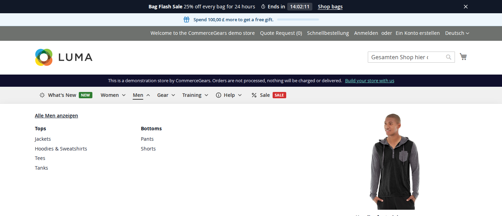
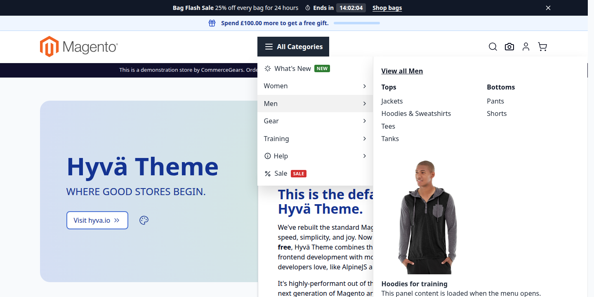
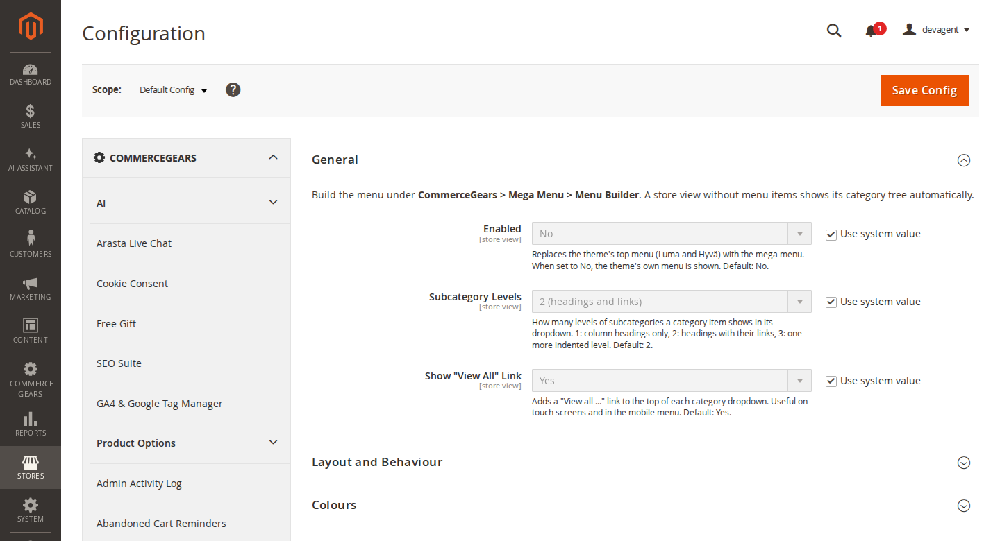
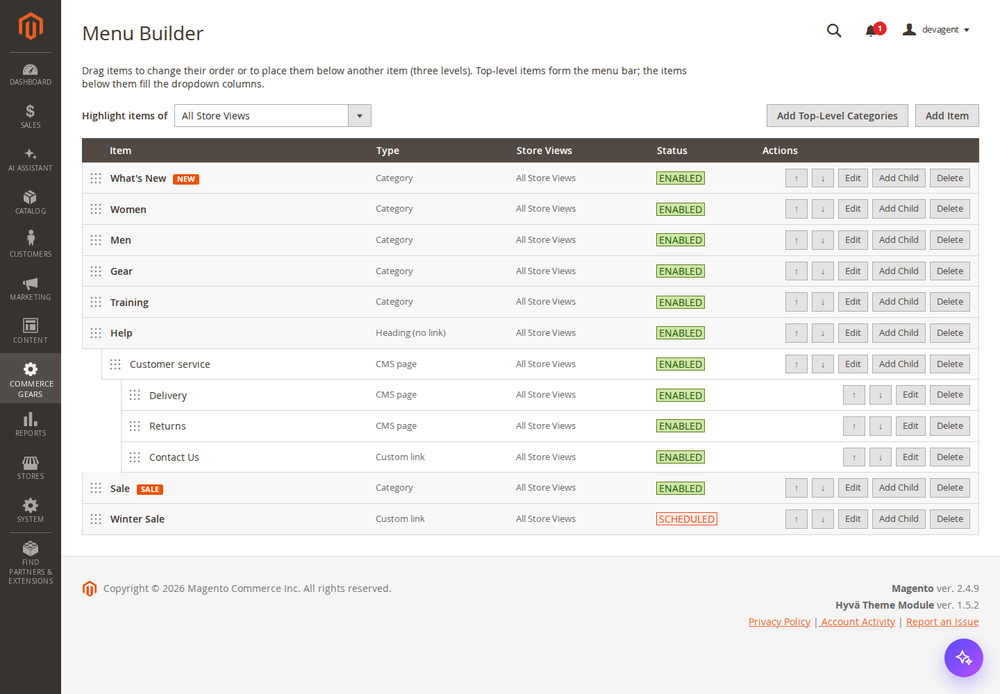
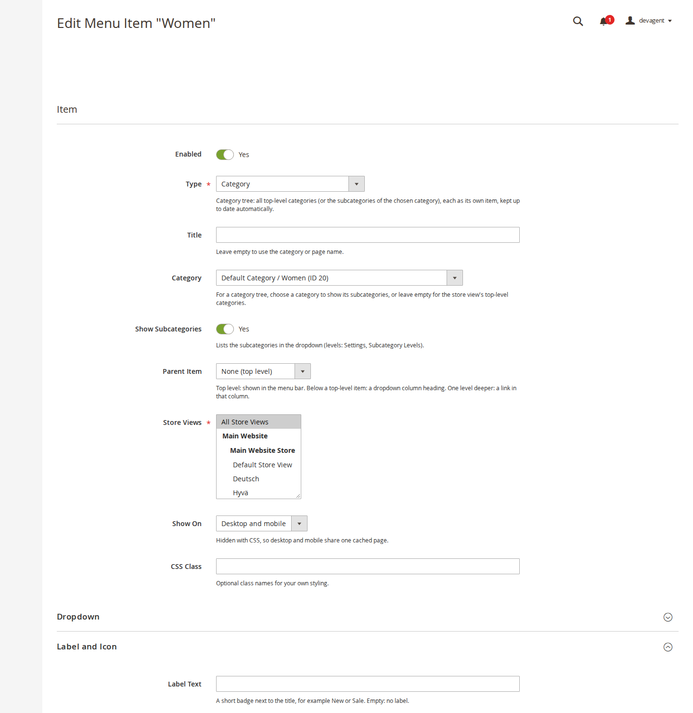
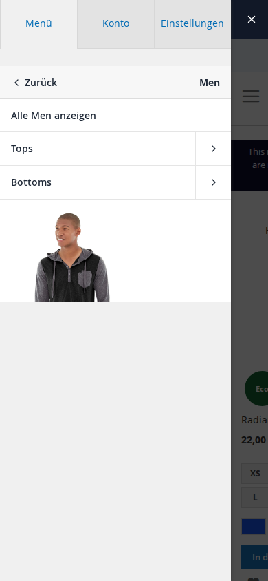
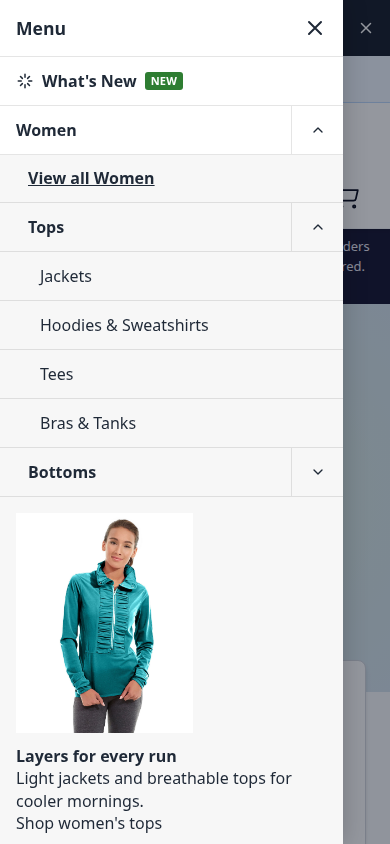

# Mega Menu for Magento 2: User Guide

Mega Menu replaces your theme's top menu on **Luma and Hyvä** with a menu you build yourself: the category tree,
your own links and CMS pages, dropdowns with columns, CMS blocks or Page Builder content and images, labels, icons,
dates and a proper mobile menu. This guide covers installation, every setting and day-to-day use.

- Demo, storefront (Luma): https://demo.commercegears.com/?tour=mega-menu
- Demo, storefront (Hyvä): https://demo.commercegears.com/hyva/?tour=mega-menu
- Admin demo: https://demo.commercegears.com/try-admin/mega-menu
- Changelog: [CHANGELOG.md](../CHANGELOG.md) · Questions: [FAQ](faq.md)



## 1. Requirements

| | |
| --- | --- |
| Magento | Open Source or Adobe Commerce 2.4.7 to 2.4.9 |
| PHP | 8.2 to 8.5 |
| Themes | Luma, Blank and themes based on them; Hyvä 1.3+ (tested with 1.5) |
| Other | `commercegears/module-core` (installed automatically) |
| Optional | Magento Page Builder, to design dropdown content with it |

Hyvä support is part of the same package. There is no separate Hyvä compatibility module to install.

## 2. Installation

With Composer. Use the Composer keys from your account on commercegears.com (see
https://commercegears.com/composer-access/):

```bash
composer config repositories.commercegears composer https://repo.commercegears.com
composer config --auth http-basic.repo.commercegears.com PUBLIC_KEY PRIVATE_KEY
composer require commercegears/module-mega-menu
bin/magento setup:upgrade
bin/magento setup:di:compile            # production mode only
bin/magento setup:static-content:deploy # production mode only
bin/magento cache:flush
```

The module is installed switched off, so nothing changes on the storefront until you enable it (section 4).
To update later: `composer update commercegears/module-mega-menu`, then the same `bin/magento` commands.

Mega Menu ships its own CSS file, so there is no Tailwind build step on Hyvä.

## 3. Quick start (10 minutes)

1. Open **CommerceGears > Mega Menu > Settings**, switch to your store view, set **Enabled** to Yes and save.
   Your storefront now shows the mega menu with the store's category tree (a store view without menu items always
   shows its categories).
2. Open **CommerceGears > Mega Menu > Menu Builder** and click **Add Top-Level Categories**. Each top-level category
   becomes its own item, ready to reorder and decorate.
3. Drag the items into the order you want and click **Save Order**.
4. Edit a category item: add a CMS block or an image to its dropdown, a "New" label or an icon. Save.
5. Add your own items with **Add Item**: a "Sale" link, a "Help" heading with CMS pages below it.
6. Check the storefront on a phone or with a narrow browser window to see the mobile menu.

## 4. Settings

**Stores > Configuration > CommerceGears > Mega Menu** (or **CommerceGears > Mega Menu > Settings**). Every setting
can be set per website and per store view.

### General

| Setting | What it does |
| --- | --- |
| Enabled | Replaces the theme's top menu with the mega menu. No shows the theme's own menu again. Default: No. |
| Subcategory Levels | How many levels of subcategories a category item shows in its dropdown. 1: column headings only, 2: headings with their links, 3: one more indented level. Default: 2. |
| Show "View All" Link | Adds a "View all ..." link to the top of each category dropdown. Useful on touch screens and in the mobile menu. Default: Yes. |

### Layout and Behaviour

| Setting | What it does |
| --- | --- |
| Desktop Layout | **Horizontal bar**: every top-level item in one row. **Hamburger (vertical list)**: one button opens a vertical list with the dropdowns beside it, good for large catalogues. |
| Hamburger Button Text | The text on the hamburger button. Default: All Categories. Only with the hamburger layout. |
| Open Dropdowns On | **Hover** or **Click** (desktop only). With Hover, dropdowns also open by click, tap and keyboard. |
| Mobile Menu Style | **Drill-down**: each level slides in with a Back button. **Accordion**: levels open below their parent. |
| Mobile Menu Below | The screen width at which the desktop menu turns into the mobile menu: 768 px (tablets get the desktop menu) or 1024 px. |
| Sticky Menu | Keeps the menu at the top of the screen while scrolling (Hyvä: the whole header; Luma: the menu bar on desktop). |



### Colours

All colours use the format `#rrggbb`. Leave a field empty to keep the theme's colour.

| Setting | Used for |
| --- | --- |
| Menu Bar Background | Background of the top-level menu bar |
| Menu Bar Text | Text and icon colour of the top-level items |
| Menu Bar Hover and Open | Text colour of a top-level item that is hovered, open or current |
| Dropdown Background | Background of dropdown panels and of the mobile menu (empty: white) |
| Dropdown Text | Links in dropdown panels |
| Dropdown Headings | Column headings (second-level items) |
| Dropdown Link Hover | A hovered or focused link in a dropdown |
| Default Label Background | Labels without their own background colour (default #d32f2f) |
| Default Label Text | Labels without their own text colour (default #ffffff) |



## 5. The Menu Builder

**CommerceGears > Mega Menu > Menu Builder** shows all items as a tree with their type, store views and status
(Enabled, Disabled, Scheduled or Ended).



- **Levels.** Top-level items form the menu bar. An item below a top-level item is a column heading in its dropdown;
  an item one level deeper is a link in that column. The menu has three levels of items.
- **Reorder** by dragging an item by its handle, or with the up and down arrows. Drop an item onto another one to
  nest it. A bar appears with **Save Order** and **Discard**; nothing changes on the storefront until you save.
- **Highlight items of** a store view to see which items that store view shows.
- **Add Item** creates a top-level item; **Add Child** creates one below an item.
- **Add Top-Level Categories** adds one item per top-level category that does not have an item yet. With a store
  view chosen in **Highlight items of**, its categories are used and the new items are assigned to that store view;
  otherwise the default store view's categories are used for all store views.
- **Delete** removes an item and the items below it, after a confirmation.

## 6. Menu items

Each item has these sections.

### Item

| Field | Notes |
| --- | --- |
| Enabled | Disabled items are not shown. |
| Type | **Category tree**: all top-level categories (or the subcategories of the chosen category), each as its own item, kept up to date automatically. **Category**: one category. **CMS page**. **Custom link**. **Heading (no link)**: text only, for example a column title. |
| Title | Leave empty to use the category or page name. |
| Category / CMS Page / Link | Depending on the type. A link is a full address (https://...) or a path in this store, for example `sale.html` or `/customer/account/`. Other schemes such as `javascript:` are refused. |
| Open in a New Tab | For links. |
| Show Subcategories | Lists the subcategories in the dropdown, as many levels as **Subcategory Levels** in the settings. |
| Parent Item | Where the item sits in the tree (you can also drag it in the Menu Builder). |
| Store Views | The store views that show the item. |
| Show On | Desktop and mobile, desktop only or mobile only. Hidden with CSS, so desktop and mobile share one cached page. |
| CSS Class | Optional class names for your own styling. |

### Dropdown

| Field | Notes |
| --- | --- |
| Link Columns | 1 to 6 columns for subcategories and child items. |
| Dropdown Width | Full width or fit content. |
| Content Position | The content (CMS block, own content, image) right of, left of or below the links. |
| CMS Block | A CMS block made with Page Builder or the editor. |
| Own Content | Shown after the CMS block. Uses Page Builder when it is installed, otherwise the editor. |
| Image, Image Alternative Text, Image Link | An image above the content (JPG, PNG, GIF or WebP), its text for screen readers (empty: the item title) and an optional link. |
| Load Content When Opened | The CMS block, own content and image load on the first hover or tap instead of with every page. Keeps pages light when the content is large. The links themselves are always in the page. |



### Label and Icon

| Field | Notes |
| --- | --- |
| Label Text | A short badge next to the title, for example New or Sale. Empty: no label. |
| Label Background, Label Text Colour | Empty: the default label colours from the settings. |
| Show Label From, Show Label Until | The label only shows between these dates. A "Sale" label can end on its own. |
| Icon | A small built-in line icon in the text colour (tag, percent, star, gift, truck and more). |
| Own Icon Image | Replaces the built-in icon, shown at 18 x 18 px. |

### Schedule

**Show From** and **Show Until** limit the item to a date range. Dates are whole days in the store view's time
zone and both ends are included. Leave them empty for no limit. The Menu Builder shows **Scheduled** for an item that
has not started yet and **Ended** for one that is over.

The menu is cached. The cron job `commercegears_megamenu_schedule` (every 10 minutes) checks whether a scheduled item
or label has started or ended and then refreshes the cached menu, so make sure Magento cron is running.

## 7. What your customers see

**Desktop.** The menu sits where the theme's menu was. Dropdowns open on hover or click, show the links in columns
and the content you added. Top-level categories and the current category are highlighted.

**Mobile.** Below the chosen width the menu becomes a drawer. On Luma it opens from the theme's menu button and keeps
the Account and Settings tabs; on Hyvä it opens from the menu button in the header.



With **Drill-down** each level slides in with a Back button; with **Accordion** the levels open below their parent.



**Keyboard and screen readers.** The menu is a `nav` landmark. Tab moves through the top-level items, arrow keys move
between items and into a dropdown, Home and End jump to the first and last item, Escape closes the dropdown and
returns focus to its item. Buttons report whether their dropdown is open, and focus is always visible.

## 8. How the theme menu is replaced

No theme file is changed. When the menu is enabled for a store view, the module adds a layout handle:

- **Luma and Blank based themes:** `commercegears_megamenu_luma` removes Magento's top menu block (`catalog.topnav`)
  and puts the mega menu into the same place (`store.menu`).
- **Hyvä based themes** (any theme that inherits from a `Hyva/*` theme): `commercegears_megamenu_hyva` removes Hyvä's
  desktop and mobile menus and makes the mega menu the only content of the header's menu block, so it appears
  exactly where Hyvä's menu was.

If your theme has a customised header, you can move the block `commercegears.megamenu` with a layout update in either
handle. When the menu is disabled for a store view, the theme's own menu comes back.

## 9. Caching and performance

- The page is rendered once for all devices: the switch between desktop and mobile is made in CSS. Full page cache and
  Varnish need no device-specific configuration.
- The menu block is cached per store view. Saving or deleting items, reordering them and saving the settings refresh
  the menu and the cached pages that contain it.
- With **Load Content When Opened**, heavy dropdown content is fetched once on first open and cached by the browser
  and full page cache.

## 10. Command line

```bash
bin/magento commercegears:megamenu:list [--store=<code|id>]
```
Prints the menu of a store view as the storefront renders it today, with schedules applied.

```bash
bin/magento commercegears:megamenu:import-categories [--store=<code|id>] [--only-this-store]
```
Adds one item per top-level category of the store view's root category (skipping categories that already have an
item). With `--only-this-store` the new items are assigned to that store view only; otherwise to all store views.

## 11. Permissions (ACL)

Under **CommerceGears > Mega Menu** in **System > Permissions > User Roles**:

- **Menu Builder**: view the builder and reorder items
  - **Add and Edit Items**
  - **Delete Items**
- **Settings**: the configuration section

## 12. Troubleshooting

- **The theme's old menu is still shown.** Check that Enabled is Yes for that store view, then flush the cache. On a
  custom theme, check that its header still contains `store.menu` (Luma) or `topmenu_generic` (Hyvä).
- **A scheduled item does not appear or disappear.** Check that Magento cron runs; the cron job refreshes the menu.
  Dates use the store view's time zone.
- **A dropdown is empty.** A category item shows its subcategories only if **Show Subcategories** is on and the
  subcategories are enabled and included in the menu (category setting "Include in Menu").
- **Content loads slowly on first hover.** That is **Load Content When Opened** at work; switch it off for small
  content, which is then part of the page.
- **Colours are not applied.** Use the `#rrggbb` format; empty fields keep the theme's colours.

## 13. Uninstall

Switch the menu off first (Enabled: No), then:

```bash
bin/magento module:disable CommerceGears_MegaMenu
composer remove commercegears/module-mega-menu
bin/magento setup:upgrade
bin/magento cache:flush
```

The theme's own menu is shown again. The tables `commercegears_megamenu_item` and `commercegears_megamenu_item_store`
and the uploaded images in `pub/media/commercegears/megamenu` are kept; delete them by hand if you no longer need them.
